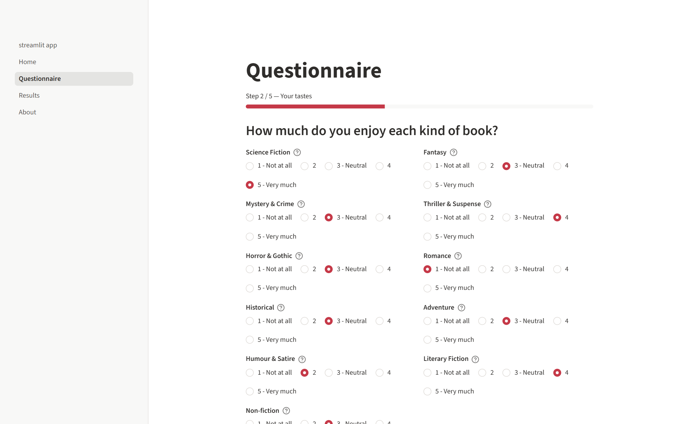
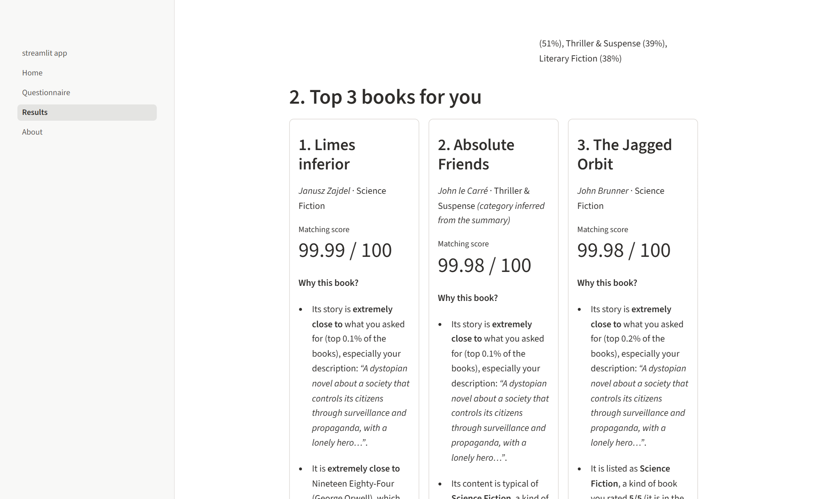
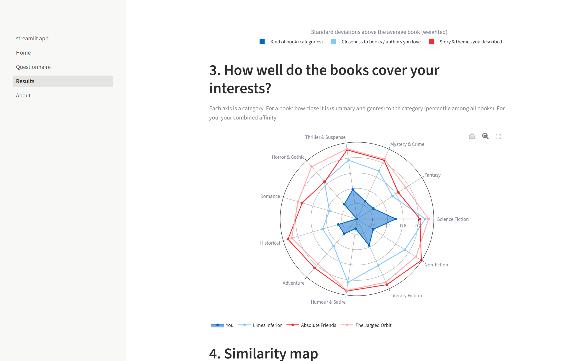
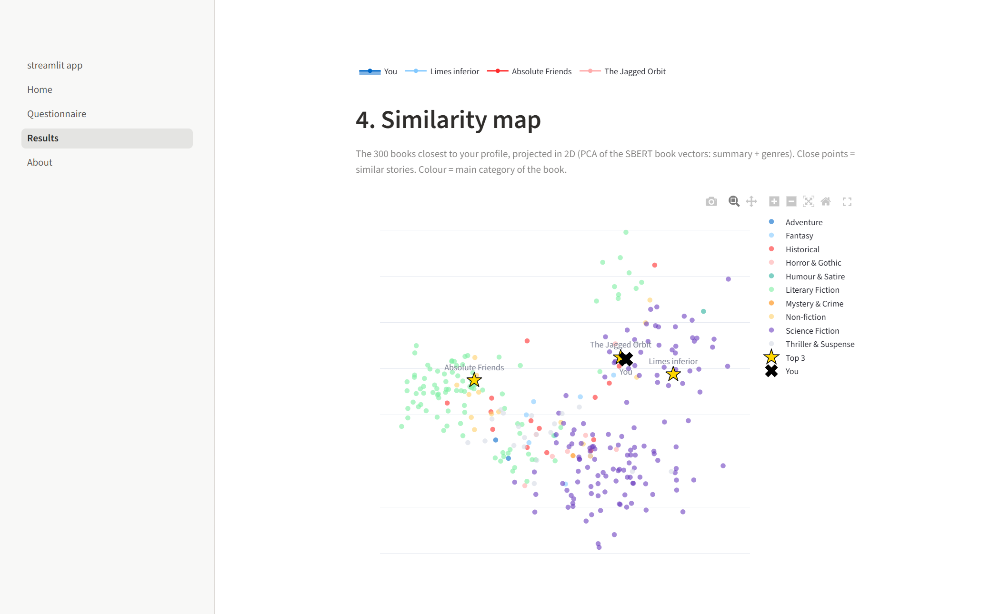

# Natural Language Processing Project

Students:
- Jade PLANTEROSE
- Hugo RIVIERE
- Thibault RABBE
- Mael VAUDIN

## Subject: Book Recommendation Based on Literary Preferences

Developing a semantic book recommendation system that identifies books aligned with the user's literary interests, preferred writing styles, themes, and narrative expectations.

The user answers a questionnaire (free texts, Likert scales, guided questions, multiple choices). The answers are
**analysed semantically** with Sentence-BERT embeddings and compared with the plot summaries of ~12,000 books.
The app returns the **Top 3 books** with a matching score, the criteria behind it, a template-based explanation and
visualizations (radar charts, score breakdown, similarity map).

| Questionnaire | Recommendations |
|---|---|
|  |  |
|  |  |

## How to run this project?

Requires **Python 3.10+**.

### Create Virtual Environment

For Windows:
```bash
python -m venv .venv
.venv\Scripts\activate
```

For Linux or Mac:
```bash
python3 -m venv .venv
source .venv/bin/activate
```

Then install the dependencies:
```bash
pip install -r ./requirements.txt
```

### Prepare the data

```bash
python -m src.main
```

This builds `data/processed/booksummaries.csv` (cleaned books + categories) from the raw file in `data/raw/`.
The embeddings (`data/embeddings/booksummaries.npz`) are versioned in the repository: if they match the books and the
model set in `configs/data.yaml`, they are reused and this step takes ~2 minutes. Otherwise they are re-computed
(**~3 h on CPU** with `all-mpnet-base-v2`). The first run also downloads the SBERT model (~420 MB) and NLTK resources;
afterwards everything works offline.

### Run the app

```bash
streamlit run ./app/streamlit_app.py
```

Pages: **Home** · **Questionnaire** (5 steps) · **Results** · **About** (data, method, model choice, scoring formula, limits).
Each submitted questionnaire is saved as JSON in `data/responses/` (not versioned).

## Repository structure

```
app/
  streamlit_app.py        entry point (multi-page navigation)
  cache.py                data and semantic engine loaded once per server
  pages/                  Home, Questionnaire, Results, About
configs/
  data.yaml               paths, embedding model and book representation
  categories.yaml         221 Freebase genres -> 11 thematic categories (+ youth audience)
src/
  main.py                 data pipeline entry point (python -m src.main)
  data/data.py            loading, cleaning, preprocessing, embeddings, categories
  data/categories.py      category mapping helpers
  nlp/embeddings.py       SBERT loading and encoding (incl. chunking of long texts)
  nlp/similarity.py       cosine similarity, percentiles, category centroids
  nlp/scoring.py          scoring formula (signals, weights, coverage, penalty, filters)
  nlp/benchmark.py        comparison of representations / models (notebook 02)
  nlp/validation.py       validation of the scoring formula (notebook 03)
  questionnaire.py        questions and conversion of the answers into a user profile
  recommendation/         Top-k ranking and template-based explanations
notebooks/                see below
data/
  raw/                    CMU Book Summary Dataset (booksummaries.txt)
  embeddings/             precomputed book vectors (.npz)
```

## Notebooks

Run them in this order (after `python -m src.main`):

| Notebook | Content |
|---|---|
| `01_data_exploration` | raw data, missing values, genres, preprocessing, thematic categories |
| `02_embedding_experiments` | why summaries are chunked, benchmark TF-IDF vs 3 SBERT models x 3 representations (`RUN_BENCHMARK`, ~1h), adding the genres to the book vector |
| `03_scoring_validation` | z-scores vs percentiles, typical profiles, ablation of the signals, sensitivity of the parameters |
| `04_demo_end_to_end` | the whole pipeline for one user, with key values recomputed by hand |

## Method in brief

- **Embeddings:** `all-mpnet-base-v2` (Sentence-BERT). Book summaries are split into sentence chunks that fit the
  model window and the chunk vectors are averaged; the book vector also includes the encoded list of Freebase genres
  (summaries rarely name their theme). Both chosen with the benchmarks of notebook 02.
- **Score of a book:** weighted mean of three semantic signals — similarity of the user's texts to the book,
  coverage of the user's preferred categories, similarity to the books / authors they love — each standardized
  (z-score) over the corpus; the result is turned into a percentile (score out of 100), minus a soft penalty for what
  the user wants to avoid. Weights come from the questionnaire.
- **Explanations:** generated from these numbers with fixed templates (no generative AI).

Details: **About** page of the app, notebooks 02-04 and the project report.

## Data

[CMU Book Summary Dataset](http://www.cs.cmu.edu/~dbamman/booksummaries.html): plot summaries of 16,559 books from
Wikipedia with Freebase metadata, released under a
[Creative Commons Attribution-ShareAlike 3.0 license](http://creativecommons.org/licenses/by-sa/3.0/us/legalcode).

> David Bamman and Noah A. Smith (2013), *New Alignment Methods for Discriminative Book Summarization*,
> [arXiv:1305.1319](http://arxiv.org/abs/1305.1319).
